# Windows Server & Active Directory | Domain Administration Lab

[](https://www.microsoft.com/en-us/windows-server)
[](https://learn.microsoft.com/en-us/windows-server/identity/ad-ds/)
[](https://learn.microsoft.com/en-us/windows-server/networking/dns/)
[](https://www.virtualbox.org/)

**Project type:** Cybersecurity home lab | **Documented by:** Alexander Cox  
**Main tools:** Windows Server 2022, Active Directory Domain Services (AD DS), DNS Manager, Active Directory Users and Computers (ADUC), Oracle VirtualBox, Windows 10

## Objective

Create a small Windows domain environment and practice fundamental enterprise administration: setting up a domain controller, managing DNS, organizing users and groups, testing domain authentication, and viewing shared resources.

The screenshots were taken during the **Cyber Home Lab** exercise. This README uses actual evidence from that document; where a screen shows only a wizard or configuration, I do not treat it as proof of successful deployment.

## Skills demonstrated

- Working with Windows Server and Server Manager
- Configuring Active Directory Domain Services and a domain controller
- Navigating DNS forward and reverse lookup zones
- Creating and managing users in organizational units (OUs)
- Applying first-logon password-change settings
- Preparing security groups for role-based access
- Testing Windows domain sign-in and viewing network shares

## Lab overview

| System | Role | Documented details |
|---|---|---|
| Windows Server 2022 (`DC01`) | Domain controller / DNS | Domain: `int.aoc.com`; NetBIOS name: `AOC` |
| Windows 10 VM | Domain authentication client | Sign-in screen shows `John.B@int.aoc.com` |
| Oracle VirtualBox | Virtualization platform | Windows Server and Windows 10 VMs shown in lab screenshots |
| AD account | Example domain user | `John Brown`, username `John.B` |
| OU / group | Identity organization | `IT Users` OU; `IT Group` Global Security group setup |

### Plain-text lab topology

```text
Windows Host / Oracle VirtualBox
|
+-- Windows Server 2022 VM: DC01
|   +-- Active Directory domain: int.aoc.com
|   +-- AD DS / DNS management
|   +-- IT Users OU
|   |   `-- John Brown (John.B)
|   +-- IT Group (Global / Security; group wizard shown)
|   `-- Shared resources: IT_Files, NETLOGON, SYSVOL
|
`-- Windows 10 VM: domain sign-in test client
    `-- John.B@int.aoc.com (domain logon and password-change screens)
```

**Addressing note:** An `ipconfig` screenshot shows the Windows Server VM at `172.60.1.2/24` with gateway `172.60.1.1`. A *separate* DNS record screenshot lists `10.0.2.15` for `dc01.int.aoc.com`. Those are observations from different screenshots; the original evidence does **not** establish one final IP configuration or show the Windows 10 client's address.

---

## Implementation steps

### 1. Prepare Windows Server and inspect network settings

I used a Windows Server 2022 VM in VirtualBox as the server for the directory-services lab. Before configuring network services, I checked the machine's IP settings using Command Prompt:

```cmd
ipconfig
```

`ipconfig` displays the IP address, subnet mask, and default gateway assigned to each Windows network adapter. These values help troubleshoot connectivity and DNS issues in a domain environment.

In the captured output, the server had:

| Setting | Observed value |
|---|---|
| IPv4 address | `172.60.1.2` |
| Subnet mask | `255.255.255.0` |
| Default gateway | `172.60.1.1` |

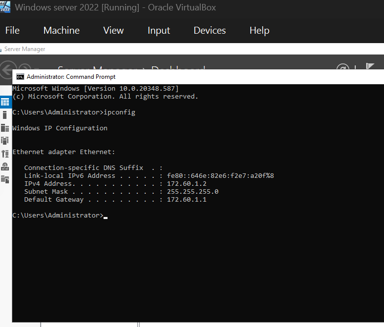

*Figure 1 — Windows Server `ipconfig` output, showing the VM's IPv4 configuration during the lab.*

### 2. Configure Active Directory Domain Services (AD DS)

I worked through the **Active Directory Domain Services Configuration Wizard**. AD DS provides centralized accounts and authentication for computers in a Windows domain.

The wizard's **Additional Options** screen shows the NetBIOS domain name `aoc`. In Windows environments, this short name is used in account formats such as `AOC\John.B`.

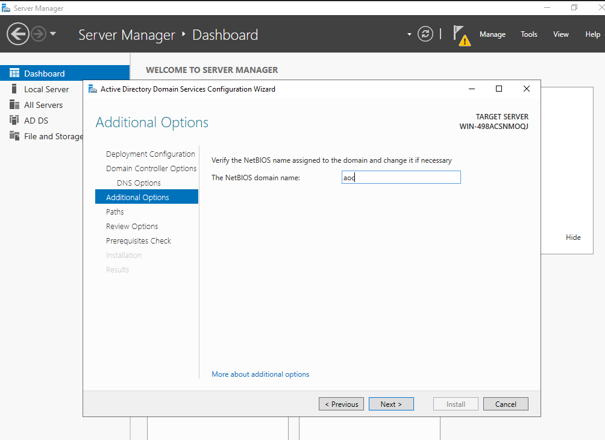

*Figure 2 — AD DS Configuration Wizard showing the NetBIOS name associated with the domain.*

After the domain configuration stage, **Server Manager → Local Server** displays the server name `DC01`, domain `int.aoc.com`, and the **AD DS** and **DNS** management sections in the sidebar.

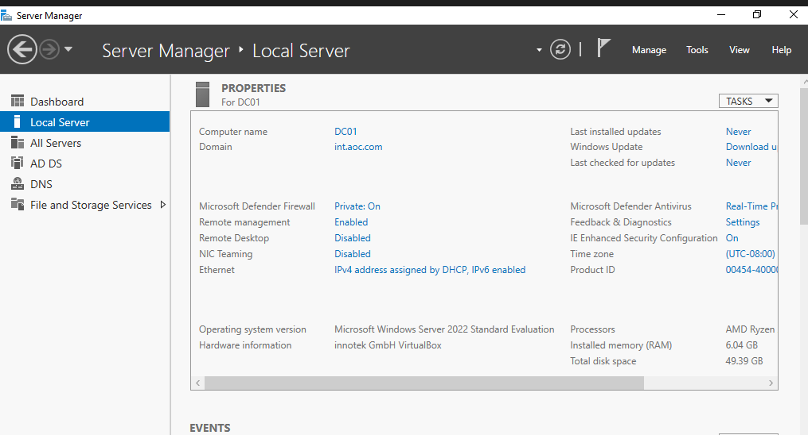

*Figure 3 — Windows Server 2022 Server Manager displaying the domain-connected server and available roles.*

**What this means:** The server is shown operating as part of the `int.aoc.com` directory environment, rather than merely as an unconfigured standalone Windows installation.

### 3. Review DNS zones and name resolution

Active Directory relies on DNS so clients can locate domain services. Using **DNS Manager**, I explored **Forward Lookup Zones** and the wizard used to create a new DNS zone.

The screenshot shows zones for `int.aoc.com` and `_msdcs.int.aoc.com`, along with the New Zone Wizard.

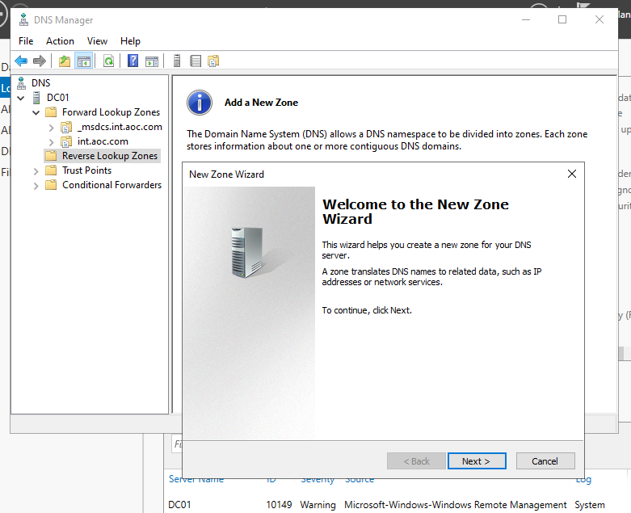

*Figure 4 — DNS Manager with the domain zones and the New Zone Wizard.*

I also reviewed a DNS name-server (NS) record for `dc01.int.aoc.com`. The record settings show `10.0.2.15` among its listed addresses **at that point in the exercise**.

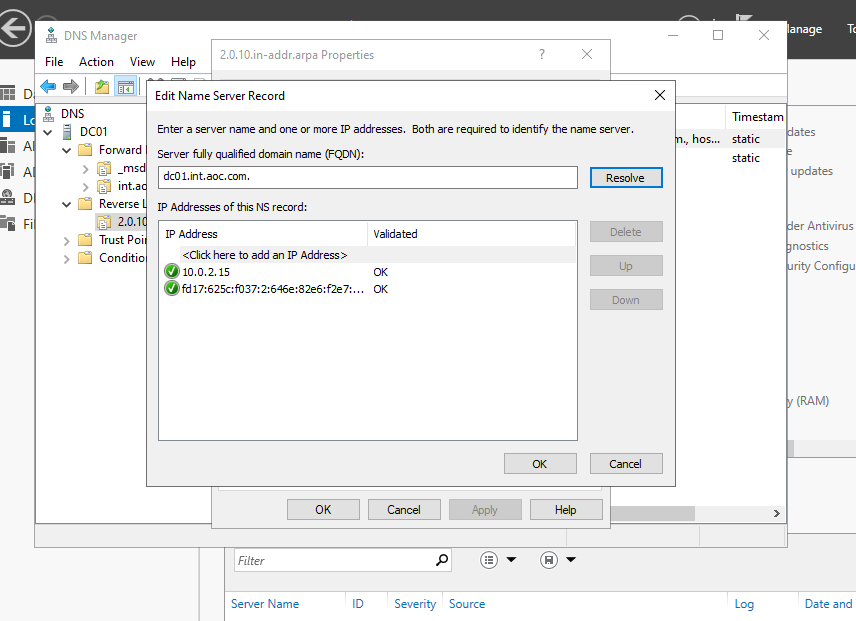

*Figure 5 — DNS record management for the domain controller.*

**Useful command for a future check (not shown as executed in the screenshots):**

```powershell
nslookup dc01.int.aoc.com
```

`nslookup` queries DNS for the name and helps verify that the record resolves to an expected address. It would be important to compare this result with the server's current `ipconfig` output because the screenshots show different address values.

### 4. Create an organizational-unit user

In **Active Directory Users and Computers (ADUC)**, the `IT Users` organizational unit was used to organize a lab user account. OUs help keep accounts together and make user administration easier.

The New User wizard shows these details:

| Field | Value |
|---|---|
| Full name | John Brown |
| Logon name | `John.B` |
| Domain | `int.aoc.com` |
| OU | `IT Users` |

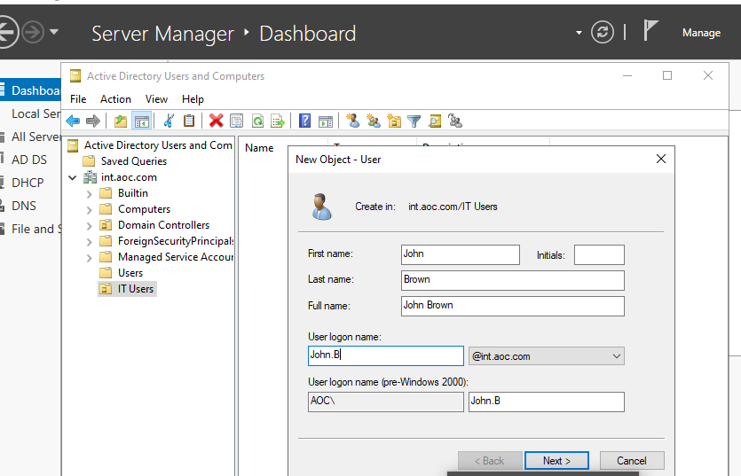

*Figure 6 — New User wizard for John Brown in the `IT Users` OU.*

The password-settings screen shows **User must change password at next logon** selected. This is a useful initial-access policy because the user should choose a password rather than continue using the temporary one.

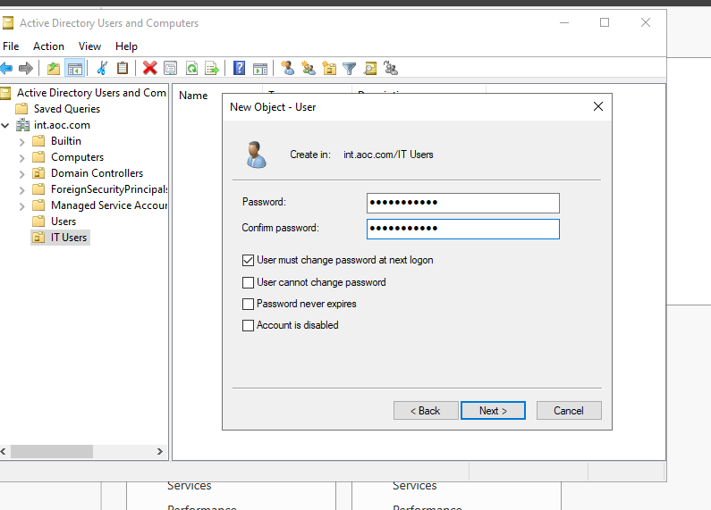

*Figure 7 — First-logon password-change option selected in the account wizard.*

The completed account is visible in the `IT Users` OU in ADUC, confirming the directory user was added.

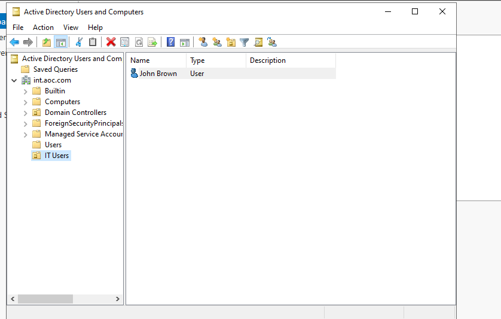

*Figure 8 — John Brown listed as a domain user in the `IT Users` OU.*

### 5. Set up an Active Directory security group

I opened **New Object → Group** in ADUC to configure `IT Group` inside the `IT Users` OU.

The wizard shows:

- **Group name:** `IT Group`
- **Group scope:** `Global`
- **Group type:** `Security`

A **security group** can be used to assign permissions to multiple users together. A **Global** group is a common choice for grouping users who share a job function within a domain.

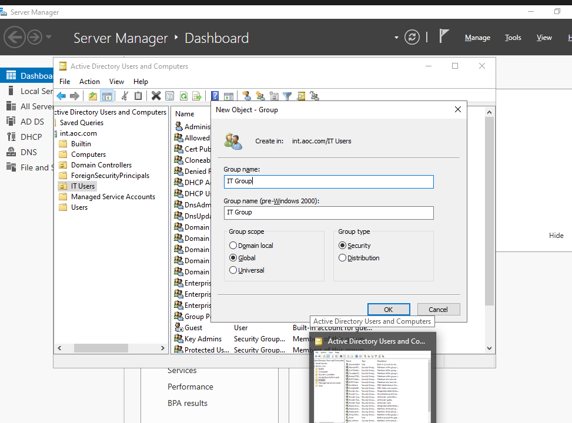

*Figure 9 — `IT Group` configured as a Global Security group in the creation wizard.*

**Evidence limit:** This is the group-creation form, not a screenshot showing final group membership or permission assignment.

### 6. Test domain sign-in from Windows 10

The Windows 10 VM was used to demonstrate domain authentication with the new user account.

The sign-in screen shows `John.B@int.aoc.com`, and Windows identifies `int.aoc.com` as the sign-in domain.

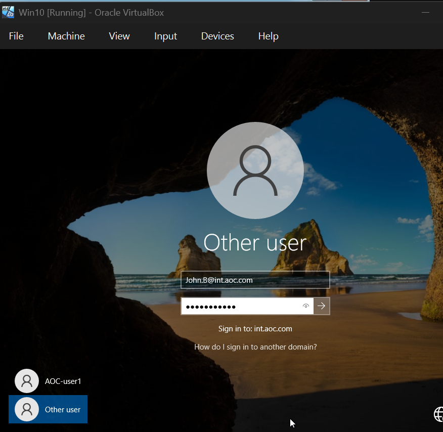

*Figure 10 — Windows 10 VM attempting to sign in using the domain account.*

A subsequent screenshot shows the message **Your password has been changed**, consistent with the first-logon password requirement configured earlier.

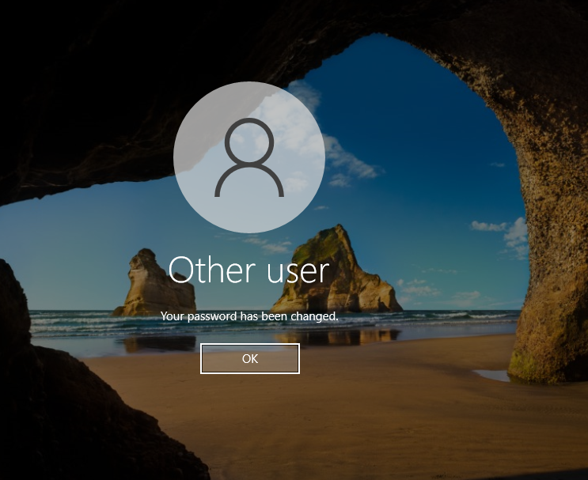

*Figure 11 — Windows confirming that the user's password was changed.*

**Result:** The screenshots demonstrate use of the domain account on the Windows 10 client and the password-change workflow. They do not show a broader authentication audit or Group Policy test.

### 7. Inspect shared resources on the domain controller

I also viewed network shares exposed by `DC01` in Windows File Explorer. These included:

| Share | Purpose |
|---|---|
| `IT_Files` | Lab file share for the IT environment |
| `NETLOGON` | Common domain share used for logon-related resources |
| `SYSVOL` | Domain share used for Group Policy and related files |

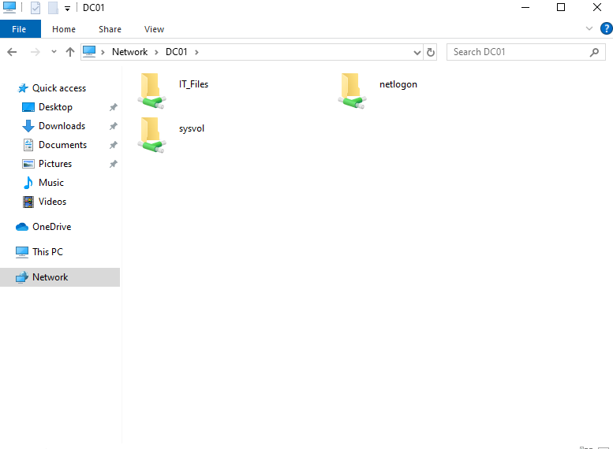

*Figure 12 — Shared folders visible under `Network → DC01`.*

The screenshot establishes that these shares were visible; it does **not** show the detailed file permissions or an access-control test.

### 8. Explore the DHCP Server role (additional configuration)

Finally, a Server Manager screenshot shows the **DHCP Server** role selected in **Add Roles and Features**. DHCP is used to automatically provide clients with IP settings such as an address, subnet mask, and gateway.

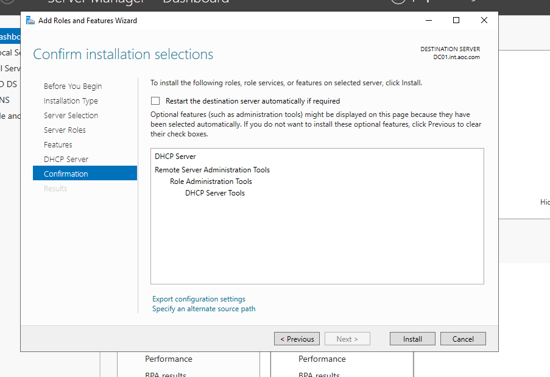

*Figure 13 — DHCP Server role on the installation-confirmation screen.*

This documents preparation to add the role; the screenshot alone does not prove a DHCP scope was created or that client leases were issued.

---

## Results

| Lab goal | Evidence-based result |
|---|---|
| Windows Server VM | Windows Server 2022 running in VirtualBox |
| AD DS / Domain | DC01 displayed in domain `int.aoc.com` |
| DNS administration | Domain zones, New Zone Wizard, and NS record reviewed |
| Domain user | John Brown (`John.B`) visible in `IT Users` OU |
| Password policy | First-logon change option and subsequent password-change confirmation |
| Security group | `IT Group` Global Security group setup documented |
| Client authentication | Windows 10 domain sign-in screen captured |
| Network shares | `IT_Files`, `NETLOGON`, and `SYSVOL` visible on DC01 |
| DHCP | Installation selection shown, but scope/lease validation not documented |

## Troubleshooting and lessons learned

- **Check DNS first when domain sign-in fails.** Clients need to resolve the domain controller correctly, not just reach the internet.
- **Keep IP and DNS records consistent.** Different addresses appeared in separate lab screenshots, so a follow-up check should confirm the server's current IP and DNS record.
- **Use OUs and groups for organization.** OUs organize directory objects; security groups are the better place to manage shared access permissions.
- **Validate with a client.** The Windows 10 sign-in and password-change screens show why end-user testing matters after account configuration.
- **Separate setup from proof.** A configuration wizard does not, by itself, demonstrate that a role or policy was successfully applied.

## Conclusion

This project provided hands-on experience with foundational Windows enterprise infrastructure: Windows Server, Active Directory, DNS, domain user administration, security-group setup, domain authentication, and shared resources.

It strengthened my understanding of how organizations centralize identities and manage access through a Windows domain, while also improving my ability to document configuration steps and distinguish verified results from settings still awaiting validation.

## Documentation and scope

- **Original source:** `Cyber Home Lab Doc 1.docx` (screenshots `image76`–`image89`; one unrelated screenshot excluded).
- **Evidence:** All images are genuine extracts from the supplied home-lab document.
- **Lab only:** This project documents a virtual practice environment, not a production deployment.
- **No fabricated terminal output:** `ipconfig` is shown in the original screenshots; `nslookup` is identified explicitly as a suggested verification command.

[Back to my GitHub portfolio](https://github.com/KerberosAC) · [LinkedIn](https://www.linkedin.com/in/alexandercox25/)
